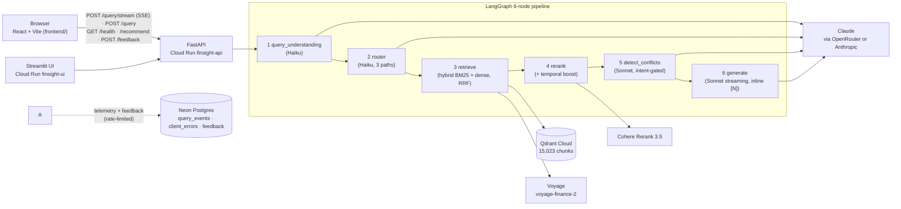

# FinSight — Multi-Source Financial Evidence Engine

[](https://github.com/aparmarthi/rag-hybrid-search-reranking-system/actions/workflows/ci.yml)
[](https://github.com/aparmarthi/rag-hybrid-search-reranking-system/actions/workflows/frontend-ci.yml)

**Production RAG system for investor-grade financial research.** Answers questions over earnings-call transcripts (15,023 chunks, 76 tickers, 2019–2023) with **cited sources, cross-call conflict detection, and honest abstention** — a 6-node LangGraph pipeline doing hybrid retrieval, reranking, and grounded generation. *(SEC-filing and OHLCV sources are ingested but not yet on the live retrieval paths — see Roadmap.)*

**Built to know what it doesn't know:** it refuses when it can't ground an answer, flags stale evidence, and surfaces contradictions between sources instead of confidently averaging them.

**Two parts:**
- **Backend** (`api/`, `src/`): FastAPI on Cloud Run running the 6-node LangGraph pipeline over Qdrant Cloud, Cohere Rerank and Claude. Serves the Streamlit demo below and the React frontend.
- **Frontend** (`frontend/`): a React + Vite evidence UI. It streams answers, maps every `[N]` citation to its evidence chunk, shows the per-node pipeline trace, and runs a live behavioral eval suite against the API. See [Frontend](#frontend).

**Live demo:** https://finsight-ui-995576020018.us-central1.run.app — ask about 2019–2023 earnings calls; get a streamed, cited answer. *(Google Cloud Run, always on — no cold start.)*
**API:** https://finsight-api-995576020018.us-central1.run.app/docs (FastAPI · `/query`, `/query/stream`, `/recommend`, `/feedback`, `/health`)
*Backup (Render free tier, ~50s cold start after idle):* [UI](https://finsight-ui-z0mp.onrender.com) · [API](https://finsight-api-otsr.onrender.com/docs)
**Measured:** hybrid+rerank beats dense-only by **+27% NDCG@10**; RAGAS faithfulness **0.81** (n=40 golden set). See [Evaluation](#evaluation).
**Status:** 🟩 Live · Weeks 1–4 complete (deploy → hybrid+rerank+LangGraph → conflict detector + evals → recs + observability), plus the React frontend with live eval, telemetry and frontend CI. Week 5 = demo video + write-up.

---

## Why this project exists

Equity analysts spend 3–4 hours per research report cross-referencing three disconnected sources: what management said on the earnings call, what the filing actually disclosed, and how the market reacted. When those sources disagree — Q2 guidance vs Q3 guidance, transcript revenue vs 10-Q revenue — today's workflow has no systematic way to surface the conflict.

FinSight retrieves across all three sources simultaneously, grounds every answer in cited sources, and flags when sources disagree. That last part — **evidence conflict detection** — turns this from a Q&A tool into a research product, and into a system that surfaces contradictions instead of confidently averaging them.

### Business value

In a regulated environment (SEC Rule 10b-5 liability on any numeric claim), a confident-but-wrong number is worse than a refusal — so the trust gates *are* the product:

- **Analyst value:** ~3 hrs/day saved × $200/hr × 20 days ≈ **$12K/month** of analyst time per seat.
- **Pricing:** $500/mo per seat (≈2.5% of a Bloomberg Terminal) → **~24× ROI** at the point of sale.
- **Unit economics:** ~$0.015/query (measured, see below) × 50 queries/day × 20 days ≈ **$15/month cost** → **~97% gross margin**.

Full model and ICP in [docs/PRD.md](docs/PRD.md) §10.

---

## Architecture



The browser calls the API directly (CORS) and talks to nothing else. Telemetry and feedback go through the API into Postgres; telemetry never stores question text. Streamlit calls the API server-side. Full architecture diagram in `docs/architecture.md`.

---

## Frontend

`frontend/` is a static React app ("FinSight: Financial Evidence Engine") that talks to the same FastAPI backend as the Streamlit demo. It has three pages:

- **Ask**
  - **Streaming answers** over `POST /query/stream` (SSE).
  - **Citations map 1:1 to evidence:** every `[N]` in the answer links to `chunks[N-1]`, and the chunk list is never re-sorted in the browser ([DEC-020](docs/decisions.md#dec-020-citation-index-invariant--n-is-chunksn-1-never-re-sorted-client-side)).
  - **Per-node pipeline trace** from `latency_per_node_ms`. On the streaming path the API returns no `generate` timing, so the trace shows generate as total latency minus the measured nodes and labels it "derived".
  - **Conflict and abstention states:**
    - A conflicts panel when the detector flags cross-call disagreement.
    - An explicit abstention view when the system refuses (`INSUFFICIENT EVIDENCE` or `grounded=false`).
  - **Related tickers** (`/recommend`), thumbs up/down (`/feedback`) and Markdown export.
  - **Demo-mode fallback:** if `/health` fails or doesn't answer within 6 s, the app replays stored responses. A "Demo mode" badge stays in the header the whole time ([DEC-021](docs/decisions.md#dec-021-demo-mode-fallback-when-the-api-is-unreachable--stale-data-clearly-labeled)).
- **Architecture:** the pipeline flow, key decisions (DEC-xxx summaries), the stack and links to resources.
- **Evaluation:**
  - **Live behavioral suite:** 9 cases with a citation-integrity check, run against the live API from the browser ([below](#b-live-behavioral-suite-frontend), [DEC-022](docs/decisions.md#dec-022-live-behavioral-eval-in-the-ui--9-cases--citation-integrity-via-non-streaming-query)).
  - **Production telemetry panel:** aggregates from real frontend traffic ([Observability](#observability), [DEC-024](docs/decisions.md#dec-024-telemetry-and-feedback-through-fastapi-into-neon-postgres-supersedes-dec-023)).
  - **Offline benchmark:** the same numbers as [Evaluation](#evaluation) below, mirrored in `frontend/src/lib/project-facts.ts`.

<!-- TODO: add a screenshot or GIF of the Ask page (answer + evidence panel + pipeline trace). No image is committed yet. -->
*Screenshot: TODO.*

The frontend isn't deployed to a public URL yet. Run it locally ([Quickstart](#run-the-frontend)) or see [Deploy the frontend](#deploy-the-frontend-static). Details are in [frontend/README.md](frontend/README.md).

---

## Tech stack

| Layer | Choice | Why |
|---|---|---|
| Vector store | Qdrant (Docker + Cloud) | Native hybrid BM25+dense in one index; free 1GB cloud tier; fastest metadata filtering |
| Primary embeddings | voyage-finance-2 | Domain-pretrained on SEC + earnings corpora. ~8–10% NDCG lift on financial retrieval |
| Fallback embeddings | BAAI/bge-m3 | MIT license; dense + sparse in one model; enables graceful degradation |
| Reranker | Cohere Rerank 3.5 | Managed cross-encoder quality; ~150ms; <$0.001/query |
| Fallback reranker | ms-marco-MiniLM-L-6-v2 | Local cross-encoder for Cohere-outage degradation |
| Orchestration | LangGraph | Stateful 6-node DAG with conditional branching; per-node LangSmith tracing |
| Primary LLM | Claude Sonnet 4.6 | Best citation-format enforcement; structured tool use |
| LLM gateway | Anthropic direct *or* OpenRouter | One config switch (`LLM_GATEWAY`); both speak the Anthropic Messages API, so tool use + streaming are identical (DEC-018) |
| Router LLM | Claude Haiku 4.5 | 10× cheaper for 3-class intent classification (earnings / metrics / risk_and_events) |
| Prompt caching | Anthropic `cache_control` | Wired on the system prompt; inactive today — prompt is below the 1,024-token cache minimum (DEC-018) |
| Structured outputs | Claude tool use + Pydantic | Citations and conflicts are schema-validated, not regex-parsed |
| Structured store | DuckDB | Columnar, 10–50× faster than Postgres/SQLite for OHLCV + fundamentals |
| Evals | RAGAS + golden set (offline) · 9-case live behavioral suite (frontend) | Industry standard faithfulness + context precision; live suite checks behavior + citation integrity against the deployed API |
| Observability | LangSmith + W&B Weave | Per-node traces; Weave `@op` on all 6 nodes, opt-in via `WEAVE_ENABLED` (DEC-017). MLflow was scoped out (DEC-016) |
| Serving | FastAPI (async) | Async handlers, Pydantic validation, connection pooling |
| Demo UI | Streamlit | Free public URL, 5-tab multi-scenario |
| Frontend | React 18 + Vite + TypeScript | Static build, any static host; talks to the API directly over CORS |
| Frontend UI | Tailwind CSS + shadcn/ui (Radix) · Recharts | Accessible primitives; latency and telemetry charts |
| Frontend tests | Vitest | 27 unit tests on the SSE parser, citation helpers and eval scoring |
| App database | Neon Postgres (serverless), via FastAPI + psycopg | Telemetry + feedback; the browser never holds a DB credential; scales to zero (DEC-024) |
| Deployment | Cloud Run (min-instances=1) + Secret Manager + Qdrant Cloud | Always-on live URL, no cold start (DEC-019) |
| CI/CD | GitHub Actions | `ci`: ruff + serve-import guard + backend unit tests. `frontend-ci`: typecheck + Vitest + build. Both run on every push/PR to `main`. The RAGAS faithfulness gate runs manually before deploy (needs keys, spends tokens) |

---

## Data sources

3 evidence sources (text + structured + time-series) + 1 golden eval set:

| Source | Dataset | Use |
|---|---|---|
| Earnings call transcripts (text) | [Motley Fool scraped transcripts (Kaggle: tpotterer)](https://www.kaggle.com/datasets/tpotterer/motley-fool-scraped-earnings-call-transcripts) | `earnings_analysis` retrieval corpus. Conflict detector Source A |
| SEC filings (structured + risk text) | [SEC Financial Statement Data Sets (EDGAR XBRL)](https://www.sec.gov/data-research/sec-markets-data/financial-statement-data-sets) | `financial_metrics` (DuckDB fundamentals, conflict detector Source B) + `risk_and_events` (10-K Item 1A risk factors, 8-K events) |
| OHLCV prices (time-series) | [Jackson Crow stock market dataset (Kaggle)](https://www.kaggle.com/datasets/jacksoncrow/stock-market-dataset) | Node 4 universal context — event-window price moves for any path. Not its own router path (see decisions.md DEC-004) |
| Golden eval | Hand-curated | 50 queries + 20+20 conflict pairs + 5 adversarial + 5 abstention |

**Router paths:** `earnings_analysis` · `financial_metrics` · `risk_and_events`. The earlier `price_action` and `news_sentiment` paths were retired — OHLCV became universal Node-4 context and the Reddit-sourced news dataset was the wrong granularity (full rationale in [docs/decisions.md](docs/decisions.md) DEC-004).

**Data licensing note:** Motley Fool dataset is hosted on Kaggle under unclear commercial redistribution terms. For public demo deployment, we scope retrieval to SEC-only mode if licensing is ambiguous. See `docs/decisions.md`.

---

## Evaluation

Two layers, measuring different things:
- **(a) Offline benchmark:** retrieval quality and faithfulness on the golden set. Run from the CLI; numbers are versioned in `evals/results/`. Ablations 1–3 below belong to this layer.
- **(b) Live behavioral suite:** does the deployed system ground, refuse and cite correctly right now? Run from the frontend's Evaluation page against the live API. It complements RAGAS; it doesn't replace it.

### (a) Offline benchmark

Measured on a 50-query golden set (40 corpus-grounded + 5 adversarial + 5
abstention). Relevance labels via LLM pooling (standard IR pooling; Claude judge).
Reproduce: `python -m src.evaluation.ablation` / `ragas_runner` / `chunking_ablation`.

| Metric | Target | Measured (Week 3) |
|---|---|---|
| Faithfulness (RAGAS) | ≥ 0.80 | **0.806** ✅ (n=40, Claude judge + Voyage embeddings) |
| NDCG@10 lift, hybrid+rerank vs dense | ≥ 10% | **+27.4%** ✅ |
| P95 latency | ≤ 3s | ❌ Live, single-user: **first token 4.3s**, full answer ~12–15s (conflict-check queries ~25–30s). No load test yet; every call costs money (DEC-018). This is end-to-end TTFT on `/query/stream`, after the pre-generation nodes run. DEC-011's 1.3s was measured in Week 1, before the query-understanding, router, rerank and conflict nodes existed (DEC-013, Week 2) |
| Cost per query | ≤ $0.005 | **$0.0135** ❌ mean (n=5 live, range $0.012–0.015) — ~3.2K tokens of retrieved evidence to Sonnet is the floor; see DEC-018 |

### Ablation 1 — Retrieval (headline: hybrid+rerank vs dense)

n=40 grounded queries, pooled-LLM relevance labels.

| Config | Recall@5 | MRR | NDCG@10 | Latency p50 (ms) |
|---|---|---|---|---|
| Dense only (voyage-finance-2) | 0.578 | 0.652 | 0.584 | 148 |
| Hybrid (BM25 + Dense RRF) | 0.655 | 0.797 | 0.718 | 145 |
| Hybrid + Cohere Rerank | 0.650 | **0.804** | **0.743** | 283 |

**Hybrid+rerank beats dense-only by +27.4% NDCG@10** (clears the ≥10% gate).
Nuance worth noting: hybrid alone captures most of the lift (0.584→0.718);
reranking further sharpens *ordering* (MRR 0.797→0.804, NDCG 0.718→0.743) but
slightly trades *coverage* (Recall 0.655→0.650) — it reranks the top set, it
doesn't retrieve more. This doubles as the **reranker ablation** (no-rerank row 2
vs rerank row 3).

### Ablation 2 — Chunking

3 strategies re-indexed on a 60-doc subset (voyage-finance-2 dense), pooled-LLM
relevance, n=40.

| Strategy | Recall@5 | NDCG@10 |
|---|---|---|
| Fixed 400-token | 0.20 | 0.130 |
| Sentence-aware | 0.20 | 0.110 |
| Paragraph | **0.25** | 0.113 |

**Honest caveat:** paragraph is marginally best on Recall, but the three are
within noise at this subset size and the absolute scores are low — the golden
queries target the *full* corpus, so a 60-doc subset under-retrieves regardless
of chunking. Distinguishing strategies conclusively needs a full-corpus re-index
(deferred — ~2 hrs embedding × 3). Reported as-is rather than cherry-picked.

### Ablation 3 — LLM comparison (Claude vs GPT-4o)

*Pending — uses the OpenRouter path (DEC-010) to swap models on the golden set.
Deferred to complete the eval block; not yet run.*

### (b) Live behavioral suite (frontend)

The Evaluation page runs 9 cases against the live API: 4 grounded, 2 conflict-check and 3 refusals. The refusals are a year before the corpus, a live-price question and a buy/sell question. The cases are the Ask page's example questions (`EVAL_CASES` in `frontend/src/lib/eval-suite.ts`). Each case gets two checks:

1. **Expected behavior.**
   - Grounded cases must answer.
   - Refusal cases must abstain.
   - Conflict cases pass only if the `detect_conflicts` node actually ran (`latency_per_node_ms.detect_conflicts > 0`).
2. **Citation integrity:** every inline `[N]` and every structured citation must point inside the returned chunk list (1..`chunks.length`).

The suite calls the non-streaming `POST /query`, not `/query/stream`. Only that endpoint returns `cost_usd` and `failure_mode`, so the run reports exact cost. The summary shows the pass rate, abstention accuracy, p50/p95 latency, total cost and tokens. Errored cases are excluded from latency. In demo mode the suite replays stored responses at no API cost.

This layer catches regressions that a one-off offline score can't: a prompt change that breaks `[N]` numbering, a guardrail that stops refusing, or the conflict gate silently turning off. It doesn't measure faithfulness or retrieval quality; that stays with (a). See [DEC-022](docs/decisions.md#dec-022-live-behavioral-eval-in-the-ui--9-cases--citation-integrity-via-non-streaming-query).

---

## Observability

**Backend:**
- **LangSmith:** per-node traces of the LangGraph pipeline. On whenever `LANGSMITH_API_KEY` is set (`LANGSMITH_TRACING` defaults to true).
- **W&B Weave:** `@op` on all 6 graph nodes, the same spans re-expressed in Weave. Off unless `WEAVE_ENABLED` is set; not enabled on the Cloud Run deploy ([DEC-017](docs/decisions.md#dec-017-built-the-deferred-two-tower-fine-tune--re-expressed-observability-in-wb-weave)).
- **Per-query logs:** a cost estimate (`cost_tracker`) and a 5-mode failure classification (`failure_tracker`), returned on `/query` and logged to JSONL. `/feedback` records thumbs up/down (Postgres when `DATABASE_URL` is set, else `logs/feedback.jsonl`).

**Frontend telemetry** (browser → `POST /telemetry/query` · `POST /telemetry/error` → Postgres; on when the API has `DATABASE_URL`, else those endpoints return 503):
- **Per query** (`query_events`):
  - outcome (grounded / abstained / error / cancelled)
  - time to first token and total latency
  - routing path, chunk count and tokens
  - cost, for non-streaming runs only, because the stream's `done` event carries no `cost_usd`
- **Uncaught client errors** (`client_errors`): the React error boundary, `window.onerror` and unhandled promise rejections.
- **Privacy:** question text is never stored. Session IDs are random per browser tab.
- **Security:**
  - The browser writes only through the API and holds no database credential. Only the API connects to Postgres.
  - Pydantic bounds mirror the CHECK constraints on every column (lengths, enums, numeric ranges); out-of-bounds input is a 422.
  - Writes (including `/feedback`) are rate-limited to 30 per minute per client IP (429 beyond that).
  - The dashboard reads only `GET /telemetry/summary?window_hours=` (1–720), which returns aggregates over live-mode traffic. Raw rows have no read endpoint.
- **Schema:** `src/telemetry/schema.sql`, applied with `python -m scripts.init_db`. Design and trade-offs are in [DEC-024](docs/decisions.md#dec-024-telemetry-and-feedback-through-fastapi-into-neon-postgres-supersedes-dec-023) (supersedes [DEC-023](docs/decisions.md#dec-023-client-telemetry-in-bolt-database-supabase-postgres-instead-of-a-vendor-sdk)).

---

## Testing & CI

| Suite | Count | What it covers | Workflow |
|---|---|---|---|
| Backend unit tests (`tests/test_unit.py`, `tests/test_week4.py`, `tests/test_telemetry.py`) | 37 | Chunker, `[N]` citation parsing, conflict-detector gates, temporal staleness, cost tracker (incl. OpenRouter model ids), failure-mode classifier, `/feedback` validation, 503 / SSE `error` degradation on LLM-provider failure and on a missing key, telemetry bounds / per-IP rate limit / 503-when-unconfigured and feedback-to-Postgres (store monkeypatched, no DB) | `ci` (`.github/workflows/ci.yml`): ruff → serve-import guard → pytest. No API calls (dummy keys) |
| Frontend unit tests (`frontend/src/lib/*.test.ts`) | 27 | **SSE parser** (`api.test.ts`, 7): events split across network chunks, CRLF line endings, a final event with no trailing blank line, server `error` events, malformed payloads, the stream ending before `done`, HTTP error detail. **Citation helpers** (`evidence.test.ts`, 13): grouped markers, `[N]` → `chunks[N-1]` without re-sorting, out-of-range citations, abstention detection, formatting. **Eval scoring** (`eval-suite.test.ts`, 7): citation integrity, abstention, the conflict-node requirement, summary aggregation, and coverage of every example question | `frontend-ci` (`.github/workflows/frontend-ci.yml`): `npm ci` → typecheck → test → build on Node 20. Path-filtered to `frontend/**` and the workflow file |
| RAGAS faithfulness gate | n=40 | Faithfulness against the 0.80 target | Manual, pre-deploy (`python -m src.evaluation.ragas_runner`). Needs API keys and spends tokens, so it's not in CI |

Run locally:
```bash
# Backend (same as CI; dummy keys are enough, no API calls)
ANTHROPIC_API_KEY=ci-dummy VOYAGE_API_KEY=ci-dummy COHERE_API_KEY=ci-dummy LANGSMITH_API_KEY=ci-dummy LANGSMITH_TRACING=false \
  python -m pytest tests/test_unit.py tests/test_week4.py
# Frontend
cd frontend && npm ci && npm run typecheck && npm test && npm run build
```

---

## Quickstart

### Prerequisites
- Python 3.11+
- Docker Desktop
- API keys: Anthropic *or* OpenRouter (`LLM_GATEWAY=openrouter`), Voyage, Cohere, LangSmith (free tiers work for dev)
- Qdrant Cloud account (free 1GB tier) — only needed for public deploy

### Setup
```bash
# Clone
git clone https://github.com/aparmarthi/rag-hybrid-search-reranking-system.git finsight
cd finsight

# Environment
python3.11 -m venv .venv
source .venv/bin/activate
pip install -r requirements.txt

# Secrets
cp .env.example .env
# Edit .env with your API keys

# Spin up Qdrant (Docker Compose, or Colima, or the native `qdrant` binary)
docker-compose up -d qdrant mlflow
```

### Reproducing the data from a clean clone

Raw datasets (~8 GB) are gitignored — fetch them first, then run the pipeline.
`artifacts/ticker_universe.json` (the 76-ticker scope) **is** committed, so the
loaders filter correctly out of the box.

**1. Fetch raw sources → `data/raw/`:**
```bash
# Motley Fool earnings transcripts (manual Kaggle download):
#   kaggle.com/datasets/tpotterer/motley-fool-scraped-earnings-call-transcripts
#   → place motley-fool-data.pkl in data/raw/motley_fool/
# OHLCV prices (manual Kaggle download):
#   kaggle.com/datasets/jacksoncrow/stock-market-dataset
#   → place stock CSVs in data/raw/ohlcv/stocks/
# SEC EDGAR filings (automated):
python scripts/download_sec_edgar.py
```

**2. Load raw → DuckDB `documents` / `prices` tables:**
```bash
python -m src.ingestion.motley_fool_loader   # transcripts → documents
python -m src.ingestion.ohlcv_loader         # OHLCV → prices
python -m src.ingestion.sec_filing_parser    # 10-K/10-Q/8-K → documents
```

**3. Chunk + embed → DuckDB `chunks` + Qdrant dense vectors:**
```bash
# Embedding backend from EMBEDDING_BACKEND (.env): "voyage" (voyage-finance-2 API,
# primary — needs a Voyage key) or "bge-m3" (local, free, ~2 hrs on Apple MPS).
# Transcripts alone ≈ 15K chunks.
python -m src.indexing.ingest_vectors --doc-type earnings_transcript
# Smoke-test first with a subset:  --limit 10
# Wipe and start over:             python -m scripts.reset_chunks
# (If you switch backends after ingesting, re-embed in place: python -m scripts.reembed_chunks)
```

**4. Add BM25 sparse vectors → enables hybrid retrieval:**
```bash
python -m scripts.add_sparse_vectors          # local
```

**5. (For live deploy) push everything to Qdrant Cloud:**
```bash
# Copies dense+sparse vectors AND embeds full chunk text into the payload, so the
# deployed app is self-contained (no DuckDB, no local model). Needs QDRANT_CLOUD_*
# in .env. Then run: python -m scripts.add_sparse_vectors --cloud
python -m scripts.push_to_cloud
python -m scripts.add_sparse_vectors --cloud
```

After steps 1–4 the full pipeline runs locally (hybrid retrieve → rerank →
LangGraph → generate). Step 5 is only needed to reproduce the live deploy.

### Run locally
```bash
# Terminal 1: API
uvicorn api.main:app --reload --port 8000

# Terminal 2: UI
streamlit run ui/streamlit_app.py
```

Or everything in Docker:
```bash
docker-compose up
```

Open http://localhost:8501 for Streamlit, http://localhost:8000/docs for API.

### Run the frontend
Needs Node 20 (the version CI uses).
```bash
cd frontend
cp .env.example .env   # every value is optional
npm ci
npm run dev            # Vite dev server
```
- `VITE_API_URL` blank → the deployed Cloud Run API. Set `http://localhost:8000` to use a local API. You can also override it at runtime from the Settings popover.
- Telemetry goes to whichever API the app is pointed at; a local API without `DATABASE_URL` returns 503 for it, which the app ignores.
- The API allows every origin by default (`CORS_ALLOW_ORIGINS` unset → `*`), so localhost works against either API.
- Never commit `frontend/.env`.

### Deploy (Cloud Run + Qdrant Cloud)
One image serves both services; the UI overrides the command to run Streamlit.
Keys live in Secret Manager (`finsight-*`), readable only by the `finsight-run` service account.
```bash
gcloud builds submit --tag us-central1-docker.pkg.dev/finsight-gpu/finsight/finsight:$(git rev-parse --short HEAD)
gcloud run deploy finsight-api --image <tag> --port 8000 --memory 1Gi --min-instances 1 \
  --service-account finsight-run@finsight-gpu.iam.gserviceaccount.com \
  --set-env-vars LLM_GATEWAY=openrouter,... --set-secrets OPENROUTER_API_KEY=finsight-openrouter-api-key:latest,DATABASE_URL=finsight-database-url:latest,...
gcloud run deploy finsight-ui --image <tag> --port 8080 --min-instances 1 --session-affinity \
  --command streamlit --args run,ui/streamlit_app.py,--server.port=8080,--server.address=0.0.0.0 \
  --set-env-vars API_URL=<finsight-api url>
```
Traffic must follow the latest revision. If it was ever pinned to a named revision, a deploy creates a healthy new revision that gets 0% traffic, while gcloud reports the pinned one as "serving 100 percent". Check with `gcloud run services describe finsight-api --region us-central1 --format="yaml(status.traffic)"` and fix with `gcloud run services update-traffic finsight-api --region us-central1 --to-latest`.
The Render backup still deploys from `render.yaml` with secrets as dashboard env vars.
Before deploying, verify the trimmed runtime has every dependency the serve path imports:
```bash
python -m scripts.check_serve_imports   # guards against requirements-serve.txt drift
```

### Deploy the frontend (static)
The frontend is a static bundle, so any static host works: Vercel, Netlify, or Cloud Storage + Cloud CDN. Navigation is in-app state and deep links use `?q=`, so no SPA rewrite rules are needed.
```bash
cd frontend
npm ci && npm run build   # outputs frontend/dist/
```
- **Build-time env vars** (from `frontend/.env.example`). Vite inlines `VITE_*` at build time, so set them in the host's build settings, not at runtime:
  - `VITE_API_URL`: API base URL. Blank → the deployed Cloud Run API.
- **CORS:** the API reads `CORS_ALLOW_ORIGINS` (comma-separated). It's unset on Cloud Run today, which means `*`, so a new frontend origin works without changes. To lock it down to the deployed frontend:
  ```bash
  gcloud run services update finsight-api --region us-central1 \
    --update-env-vars CORS_ALLOW_ORIGINS=https://<frontend-origin>
  # several origins: gcloud needs an alternate delimiter because the value contains commas
  #   --update-env-vars "^;^CORS_ALLOW_ORIGINS=https://<frontend-origin>,http://localhost:5173"
  ```
  Once this is set, any origin not listed (including local dev) is blocked. The Streamlit UI calls the API server-side, so CORS doesn't affect it.

### Run evals
```bash
python -m src.evaluation.ablation          # retrieval ablation (dense vs hybrid vs hybrid+rerank)
python -m src.evaluation.ragas_runner      # RAGAS faithfulness vs the 0.80 gate
python -m src.evaluation.chunking_ablation --max-docs 60
# ablation / ragas_runner accept --limit N for a quick pass
```

---

## Repository layout

```
finsight/
├── data/                    # DVC tracked, gitignored if >50MB
├── notebooks/               # Exploration only (01_eda · 02_chunking_eval · 03_conflict_calibration)
├── src/
│   ├── ingestion/           # Load raw → DuckDB documents/prices (loaders + SEC parser)
│   ├── indexing/            # chunker, embedder (voyage/bge-m3), sparse BM25, Qdrant upsert
│   ├── retrieval/           # retriever (hybrid), reranker, LangGraph graph/nodes/state
│   ├── generation/          # Sonnet streaming + inline-citation parsing
│   ├── insight/             # Evidence Conflict Detector — THE differentiator (Week 3)
│   ├── guardrails/          # Input + output safety (Week 4)
│   ├── recommendations/     # Shared-embedding related-tickers (Week 4)
│   ├── evaluation/          # RAGAS + ablations + LLM comparison (Week 3)
│   └── utils/               # Config, logging
├── api/                     # FastAPI: /health, /query, /query/stream, /recommend/{ticker}, /feedback, /telemetry/*
├── ui/                      # Streamlit demo (5 tabs)
├── frontend/                # React + Vite evidence UI (Ask · Architecture · Evaluation)
│   ├── src/lib/             # API client + SSE parser, citation helpers, eval suite, telemetry, project facts (+ Vitest tests)
│   ├── src/components/      # finsight/ feature components + shadcn/ui primitives
│   └── .env.example         # VITE_API_URL (optional)
├── tests/                   # Backend pytest suite (unit + Week-4 API/degradation tests)
├── .github/workflows/
│   ├── ci.yml               # ruff + serve-import guard + backend unit tests
│   └── frontend-ci.yml      # frontend typecheck + Vitest + build (path-filtered to frontend/**)
├── scripts/                 # data download, ingest iteration, sparse vectors, cloud push
├── docs/
│   ├── PRD.md               # Problem, users, metrics, trade-offs, ROI
│   ├── architecture.md      # Diagrams, state schema, module boundaries (✅/🔷 marked)
│   ├── decisions.md         # Engineering war stories — interview artifact (DEC-001…024)
│   ├── deployment-playbook.md   # How I'd deploy this at a regulated customer (FDE artifact)
│   ├── interview-positioning.md # Role → question → artifact map
│   └── finsight_spec_v2.3.md  # Canonical spec
├── artifacts/ticker_universe.json  # 76-ticker corpus scope (committed)
├── render.yaml              # Render blueprint (finsight-api + finsight-ui)
├── docker-compose.yml
├── Dockerfile
├── requirements.txt
└── requirements-serve.txt   # minimal runtime for Render deploy
```

---

## Roadmap (5-week interview-scoped plan)

- **Week 1** — ✅ End-to-end skeleton + live Render URL (voyage-finance-2 embeddings, streaming cited answers, abstention)
- **Week 2** — ✅ Full retrieval pipeline: hybrid BM25+dense (native RRF), Cohere Rerank 3.5 + local fallback, 6-node LangGraph pipeline (query-understanding → 3-path Haiku router → retrieve → rerank → conflict-detect → generate), query-relative temporal recency boost + staleness, LangSmith tracing.
- **Week 3** — ✅ Evidence conflict detector (precision-gated), 50-query golden set, retrieval ablation (**hybrid+rerank +27.4% NDCG** vs dense), RAGAS faithfulness (**0.806**, passes 0.80 gate), chunking ablation, 12 unit tests, lightweight CI (lint + import-guard + tests). 🔷 Skipped by choice: Claude-vs-GPT LLM bake-off (stale target), MLflow (one-shot ablations → git-versioned JSON instead).
- **Week 4** — ✅ Related-tickers recs (shared-embedding NN), per-query cost tracker, 5-mode failure logger, `/recommend` + `/feedback` endpoints, 5-tab Streamlit demo. 🔷 Remaining: live load-test run (P95, token-budget-gated), multi-turn context (deferred — low ROI on tab UI).
- **Week 5** — 🔷 Pending: demo Loom video, blog post, LinkedIn Featured *(your distribution work)*.
- **Frontend** — ✅ React evidence UI (`frontend/`): streaming answers with 1:1 `[N]` → chunk citations, per-node pipeline trace, conflict and abstention states, labeled demo-mode fallback. ✅ Live 9-case behavioral eval with citation integrity on the Evaluation page. ✅ Client telemetry + feedback through the API into Neon Postgres, rate-limited, with an aggregate dashboard (DEC-024). ✅ `frontend-ci` (typecheck + 27 Vitest tests + build). See [DEC-020…023](docs/decisions.md#dec-020-citation-index-invariant--n-is-chunksn-1-never-re-sorted-client-side). 🔷 Remaining: public hosting for the frontend.
- **Bonus (training + observability)** — ✅ Two-tower bi-encoder fine-tune (`sentence-transformers`, in-batch-negative contrastive loss) on leakage-guarded domain pairs: **Recall@5 0.825 → 0.870 (+4.5 pts mean, range +2.5 to +5.0 across 5 seeds; positive on all 5)** on 40 held-out golden queries vs a 3000-chunk pool ([evals/results/finetune_seeds/](evals/results/finetune_seeds/), runs on [W&B](https://wandb.ai/ameyparmarthi-finsight/finsight-biencoder-finetune)). Plus **W&B Weave** tracing (`@op` on all 6 nodes) alongside LangSmith. See [DEC-017](docs/decisions.md).

Full plan: [docs/finsight_spec_v2.3.md](docs/finsight_spec_v2.3.md). How this project maps to specific roles — and how I'd deploy it at a real customer — is in [docs/interview-positioning.md](docs/interview-positioning.md) and [docs/deployment-playbook.md](docs/deployment-playbook.md).

---

## Future Work (scoped out of v2.3 for timeline; listed for awareness)

- BEIR FiQA-2018 generalization benchmark
- 3-LLM consensus judge (Claude + GPT + Gemini) to reduce self-preference bias
- Arize Phoenix embedding cluster visualization
- DeepEval as second eval framework (pytest-native)
- Semantic chunking (SemanticChunker) as 4th chunking ablation row
- Int8 scalar quantization on Qdrant
- Related queries + personalized doc feed (v2.3 keeps only related tickers)
- 10-K Item 1 graph edges for competitor peer identification
- Llama 3.1 8B local/private deployment via Ollama
- Cohen's kappa human evaluation with inter-annotator agreement
- Adversarial test suite as separate module (v2.3 folds 5 adversarial queries into golden set)
- Multi-turn conversation memory compression for long sessions
- ahmedsta/data-retreiver chart-image modality

---

## About

Built by [Amey Parmarthi](https://www.linkedin.com/in/ameyparmarthi) — AI Deployment Strategist at Salesforce, leading Agentforce deployments at Fortune 500 scale in regulated industries.

Related portfolio project: [KKBox Customer Retention ROI Platform](https://amey-churn-predictor.streamlit.app/) — end-to-end production ML on 31GB subscription data, dual-policy decision engine netting $17,666 in simulated net ROI.

---

## License

MIT (code). Data sources retain their own licensing — see `docs/decisions.md` for data-licensing notes.
